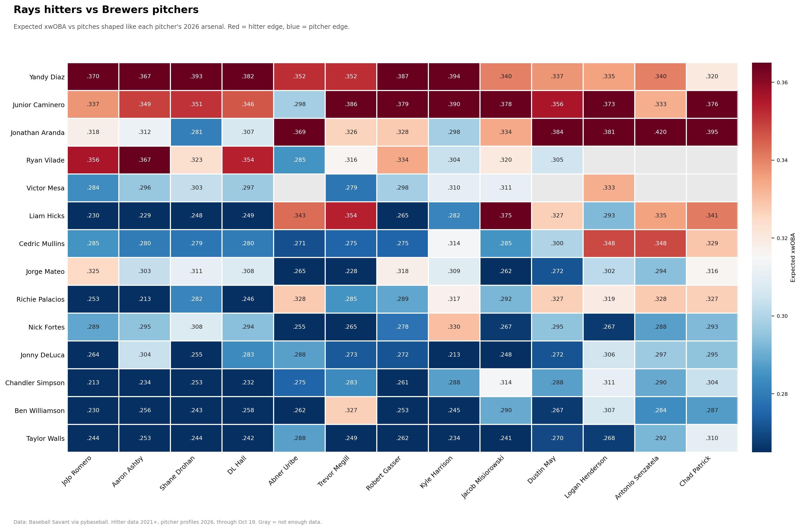
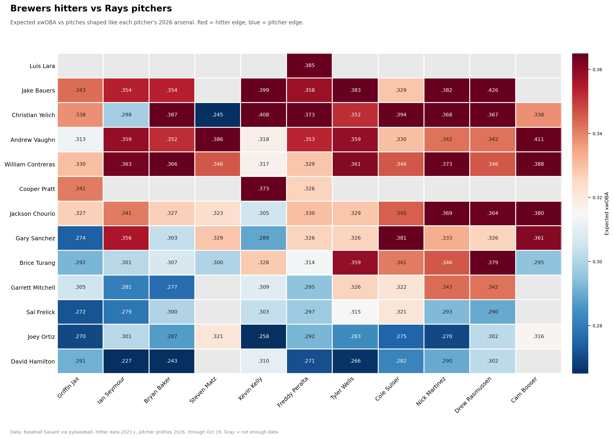

# 2026 World Series Preview: Rays vs. Brewers

A pitch-shape matchup model projecting how each hitter would fare against each opposing pitcher in the 2026 World Series.

## Results

### Rays hitters vs. Brewers pitchers

### Brewers hitters vs. Rays pitchers

Red = hitter edge, blue = pitcher edge, white ≈ league average (.315 xwOBA). Gray = not enough data.

## Why not head-to-head stats?
Career batter-vs-pitcher samples are tiny, often under 10 plate appearances, and many of these players had never faced each other. **These numbers are not actual matchup results.** Each matchup is projected from how a hitter has performed against pitches that look like the ones that pitcher throws.

## Method
1. **Pitcher profiles:** For each pitcher, I calculated the 2026 average velocity, spin rate, and horizontal and vertical movement of each pitch type, plus how often he throws it. Pitches used less than 5% of the time are dropped.
2. **Find look-alike pitches:** For each pitch in that arsenal, I searched the hitter's plate appearances since 2021 for the **30 most similar pitches**. Each one had to be the same pitch type, thrown by a pitcher of the same handedness, and have the closest velocity, spin, and movement (nearest-neighbor matching on standardized features).
3. **Measure the hitter:** I averaged the hitter's xwOBA on those look-alike pitches, counting only the pitch that ended each plate appearance.
4. **Shrink toward the hitter's baseline:** I blended that result with the hitter's overall xwOBA against that pitch type, so a handful of lucky or unlucky outcomes can't dominate.
5. **Combine:** I weighted each pitch type's result by the pitcher's usage to get one expected xwOBA per matchup.

I used **xwOBA** instead of wOBA because it's based on quality of contact (exit velocity and launch angle), which filters out luck from defense and ballparks. Strikeouts, walks, and HBPs use their actual wOBA values.

## Limitations
- Doesn't account for pitch location, count, or sequencing.
- Pitch mix is the pitcher's overall mix, not split by whether he's facing a lefty or a righty.
- Release point and extension aren't in the matching, so two pitches with similar movement can still look different to a hitter.
- Hitter skill changes over 2021–2026 aren't weighted toward recent seasons.

## Tools
Python · pandas · NumPy · matplotlib · pybaseball · Google Colab